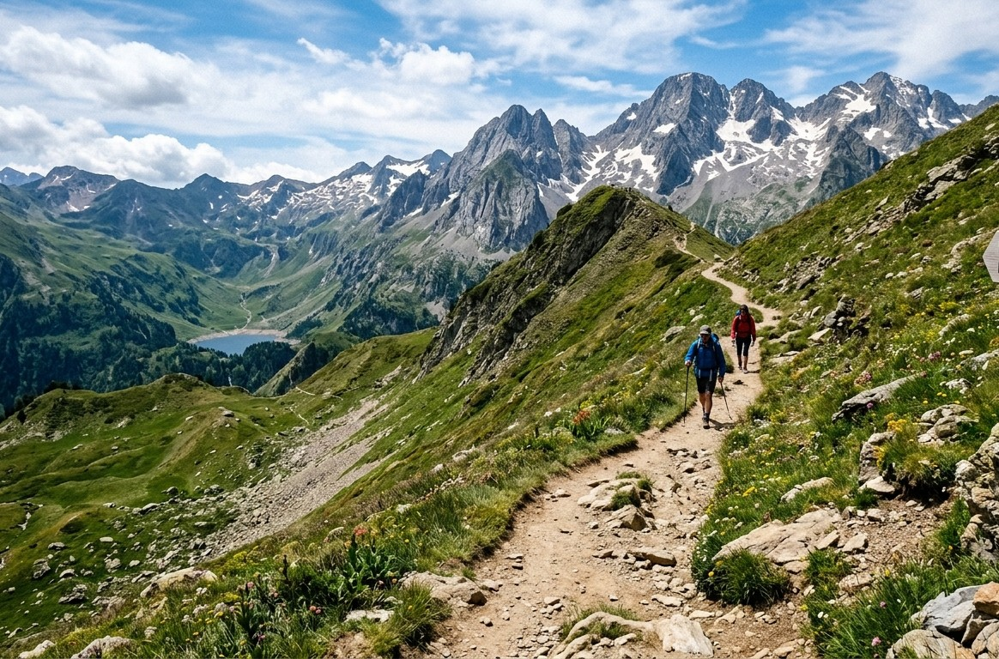
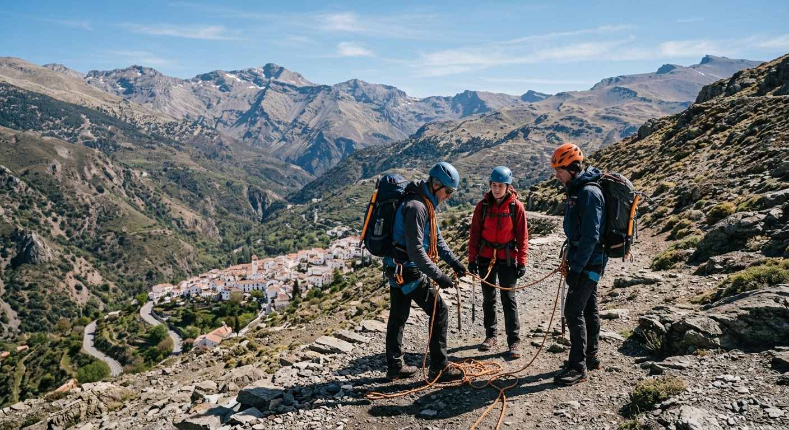
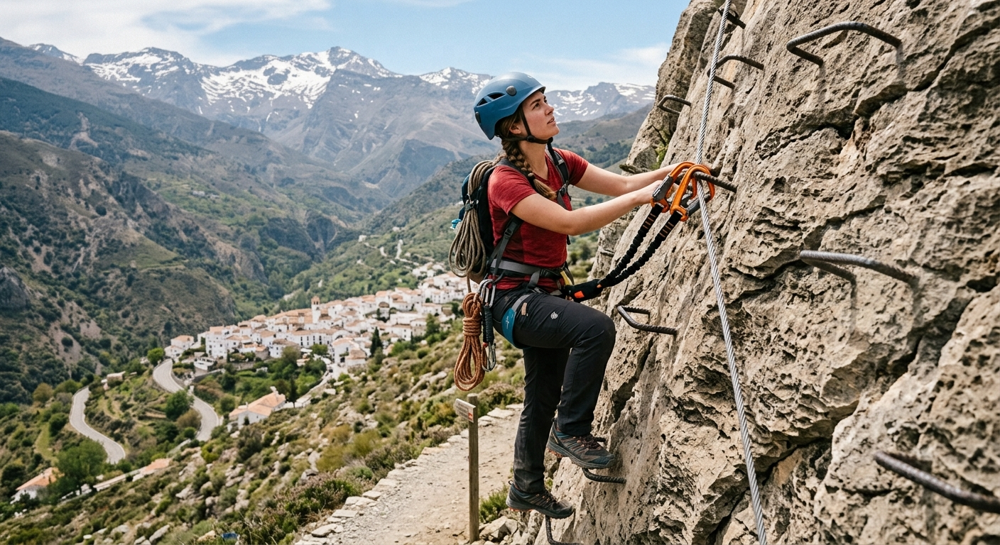
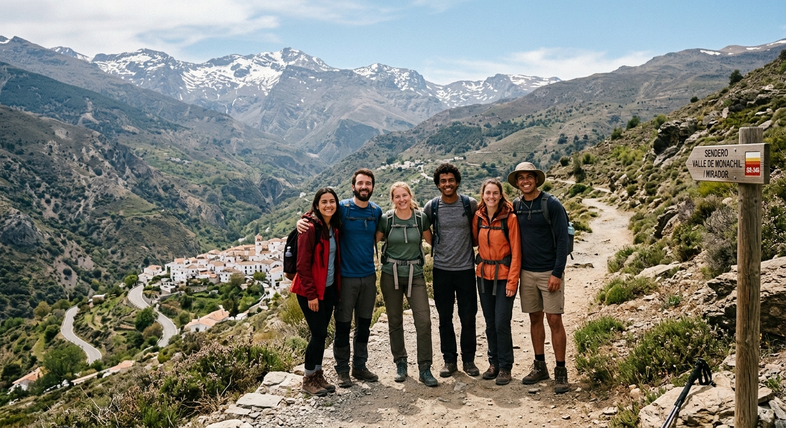
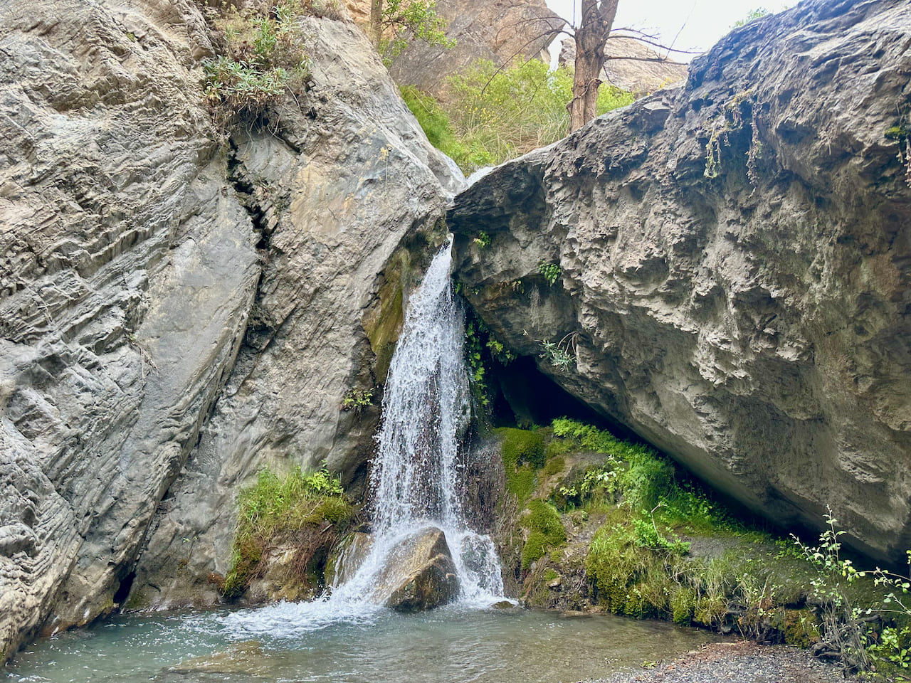
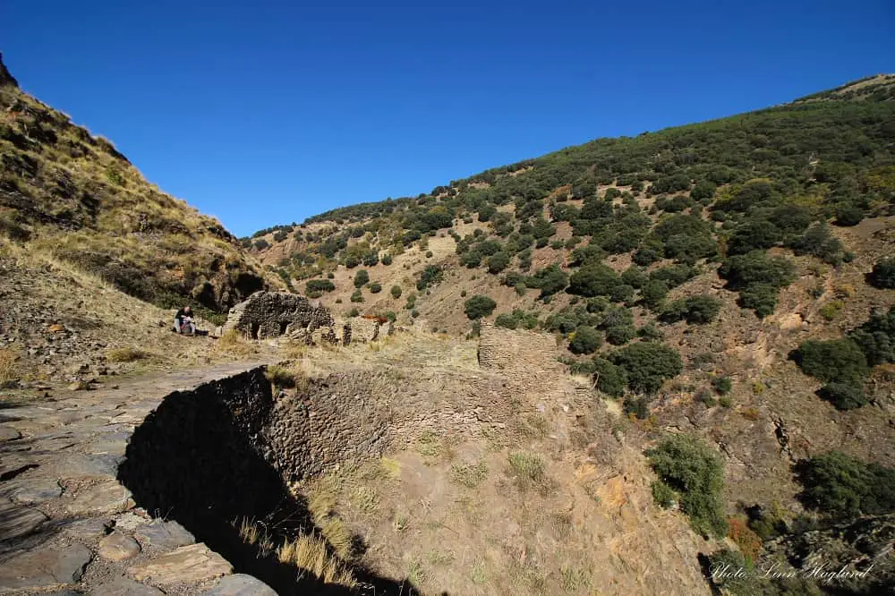
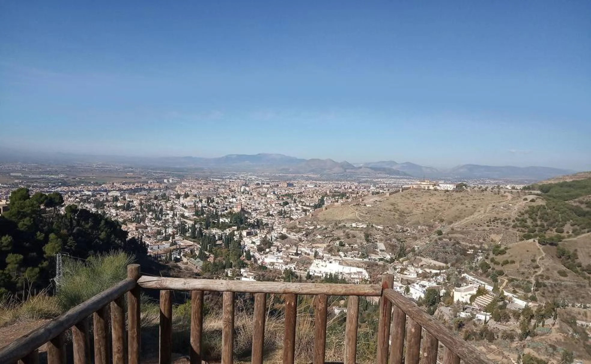
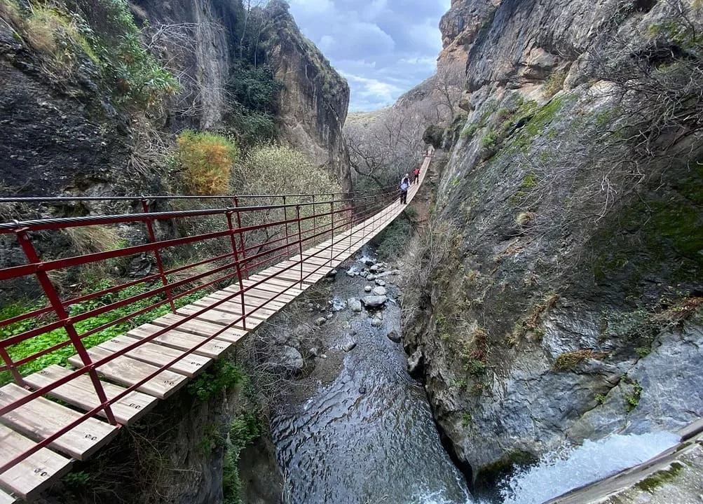

## README

He elegido Html por que es el que sabemos ahora mismo.

La pagina trata sobre rutas de Granada

**Procedencia de las fotos**

He elegido para la cabecera el quienes somos y los cursos imagenes generadas po IA que son estas: 

# Generadas por Gemini

# Importadas de la webs

Las imagenes que hacen referencia a rutas son escogidas de la web.

Para darle mas realismo a las rutas estas si las he cogido de la web, aqui debajo dejo cada link para que se pueda acceder a la pagina para ver mas información.

([ruta de la pavilla ](https://milyunarutas.com/sendero-de-la-pavilla))

************************************************************************

([Vereda de la estrella](https://andaluciahiking.com/hike-vereda-de-la-estrella-granada-sierra-nevada/))

************************************************************************

[Dehesageneralife](https://www.ideal.es/planes/dehesa-generalife-paseo-20210624122607-nt.html?ref=https%3A%2F%2Fwww.ideal.es%2Fplanes%2Fdehesa-generalife-paseo-20210624122607-nt.html)

[Cahorros](https://sendasdeviaje.com/ruta-los-cahorros-monachil-granada/)

## Proyecto

Como indican las R.A he utilizado uno de cada elementos que pide , he incluso he repetido en algunos.

**Lo he subido a Netlify.**

https://clubdemontana.netlify.app

La página web está pasada por WAVE para comprbar la accesibilidad de esta.

